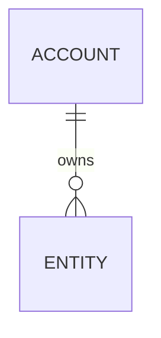

# Core context

This document is the entry point for the shared domain model. Fill it for your project. Agents read it before they name a table, an endpoint or a module.

How to fill it:

- Write one row in **Terms** for each domain term. Use one name for one thing in code, API, specs and UI text.
- Draw only the relationships that your sources state. Mark the open points.
- Keep it conceptual. The real schema is in the migrations, and the real operations are in the API contract.
- Only the orchestrator changes this file (see `CLAUDE.md`).

## Sources and implementation status

[Brief](docs/dev/brief.md) describes the product. [ADR 0005](docs/dev/adr/0005-api-surfaces-and-ownership.md) defines the API sections and data ownership. [ADR 0009](docs/dev/adr/0009-account-isolation-rls.md) adds database isolation. [ADR 0003](docs/dev/adr/0003-analytics-outbox-and-sinks.md) defines the event log and the analytics boundary.

The model below is conceptual. It does not describe deployed tables. The template contains health checks, database roles, isolation helpers and API code generation. It has no domain entities. Check the [migrations](core/migrations) and the [API contract](api/openapi.yaml) for the implemented schema and operations.

## Terms

| Core term | In your product | What it is |
| --- | --- | --- |
| Account | <for example: a company, a team> | The one who pays and owns the data. The tenant |
| <term> | <word that users see> | <one or two sentences> |

An account is a tenant, not a login identity. Add the rules that separate similar terms here.

The glossary is in [THESAURUS.md](docs/dev/THESAURUS.md). It gives each term, its code name and the names to avoid. Search it before you name a thing.

## Conceptual relationships

Show only the relationships stated in the sources. All account-owned entities stay isolated, also when the diagram does not show the ownership edge.

## Ownership and routing scenarios

- A dashboard request uses the account from the session. A public page uses the account from its address. The browser does not select `account_id` ([ADR 0005](docs/dev/adr/0005-api-surfaces-and-ownership.md)).
- <Add one line for each scenario that crosses accounts or entry points.>

## Open points

<List the questions that a slice specification must settle before implementation. Do not infer a physical schema from this document.>
