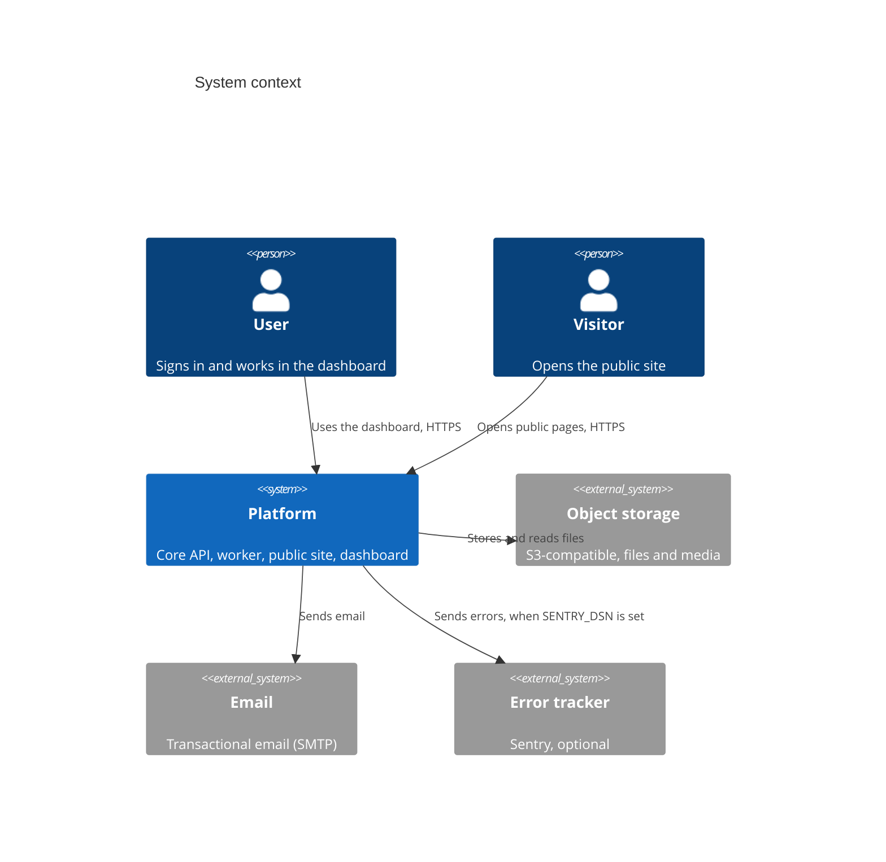
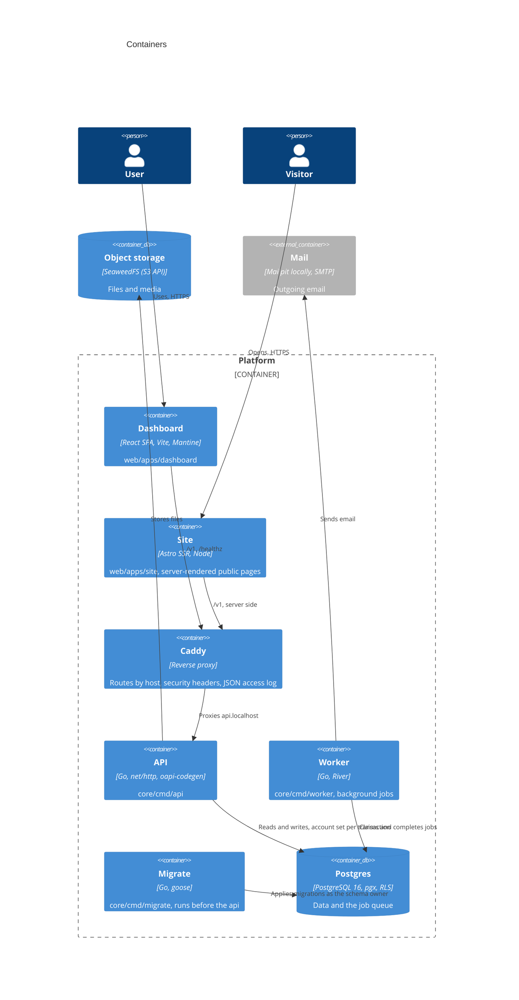
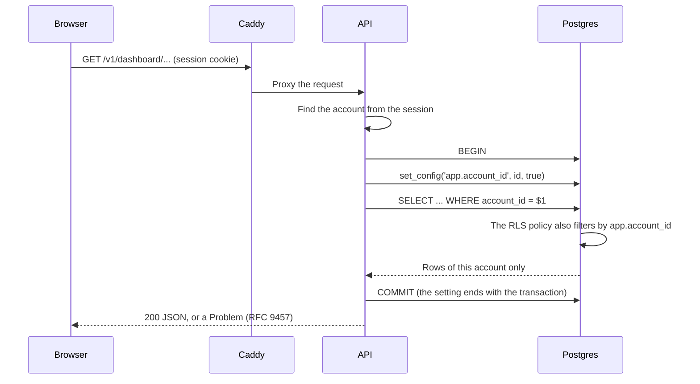

# Architecture: C4 and sequence diagrams

This document shows the shape of the template as diagrams. It does not add new decisions. Each diagram links to the ADR that decided it. When the project gets a domain, add the people, the external systems and the main flows here.

## C4: System context

## C4: Containers

The containers are the services in [deploy/compose.yaml](../../deploy/compose.yaml) and the apps in `web/apps/`.

**What exists now.** The api serves `/healthz` only. The worker starts and waits for a signal. River queues come with the first job. Compose gives the core the database, S3 and SMTP settings, but only `migrate` connects to the database now. The arrows to S3 and mail show the intended use. The site and the dashboard run as dev servers (ports 4330 and 5173). Locally, Caddy routes `api.localhost`, `mail.localhost` and `s3.localhost` only. Details are in [deploy/README.md](../../deploy/README.md).

**One image for the core.** `api`, `worker` and `migrate` are three binaries in one image ([ADR 0007](adr/0007-monorepo-layout.md)).

**Three database roles** ([ADR 0009](adr/0009-account-isolation-rls.md)):

| Role | Used by | RLS |
| --- | --- | --- |
| `app_owner` | `migrate` | Owns the tables. `FORCE` applies to it too |
| `app_app` | `api`, `worker` | Applies |
| `app_system` | Only marked places | `BYPASSRLS`. The review checks each use |

## Sequence: a request with the account context

This is the path of each request to account data. `db.WithAccount` (`core/internal/platform/db`) is the one entry point.

**Two layers.** The code filters by `account_id`, and the RLS policy filters again. A missing filter in code returns an empty result, not another account's rows. The API never takes `account_id` from the browser ([ADR 0005](adr/0005-api-surfaces-and-ownership.md)).

## Rules for the code structure

These rules keep the core easy to change. The code rules are in the [backend standard](backend-standard/README.md).

- **Layers point down.** Shared core modules do not know the product modules above them. Product modules call the core. The core does not call them.
- **Tiers for a module.** "Now": what the first slices need. "In the model": in the schema and the contract, with no screens or logic. "When needed": add it when real use shows the need.
- **External sources connect in four directions.** Each direction has one pattern. A new source is a new adapter, and the core does not change.

| Direction | How it connects |
| --- | --- |
| Incoming webhooks | `/v1/webhooks/<source>` → signature check → save the raw request with an idempotency key → respond at once → a River job sends it through the adapter |
| Pull from a source | A River job calls the source through an adapter. The result becomes a draft |
| Outgoing calls | Through a core interface (port) with one implementation per provider. Always in a River job, with retries and a timeout |
| Event streams | Outbox → River → sink adapter ([ADR 0003](adr/0003-analytics-outbox-and-sinks.md)) |

- **The adapter translates, the core decides.** The adapter knows the source format. It does not know the business rules.
- **Each input links to an account.** If the link fails, the input goes to the dead-letter queue, not to a random account.
- **Idempotency.** A repeated webhook or job does not create a duplicate.
- **Account secrets** are encrypted in the database. The key is outside the database.
- **Tests use recorded responses** of each source, so CI finds a format change.
- **No seam for the future.** Add an extension point only when there are at least two real cases.

## Base decisions this architecture assumes

| Decision | ADR | What it fixes here |
| --- | --- | --- |
| Account isolation | [0009](adr/0009-account-isolation-rls.md) | Each table with `account_id` has an RLS policy. The API sets `app.account_id` once per transaction |
| API sections and ownership | [0005](adr/0005-api-surfaces-and-ownership.md) | `/v1/dashboard`, `/v1/public`, `/v1/webhooks`. Composite foreign keys. The server finds the account |
| Analytics event log | [0003](adr/0003-analytics-outbox-and-sinks.md) | The core owns the `events` table. A sink adapter forwards a copy |
| Monorepo layout | [0007](adr/0007-monorepo-layout.md) | `api/`, `core/`, `web/`, `deploy/`, one Taskfile, one CI pipeline |
| Dashboard UI library | [0001](adr/0001-dashboard-ui-library.md), [0008](adr/0008-dashboard-mantine.md) | The dashboard uses Mantine |
| Specs | [0002](adr/0002-specs-openspec-hybrid.md) | `openspec/changes/<id>/` holds the proposal that a slice implements |

## Out of scope here

- Physical table design (columns, indexes): a proposal under `openspec/changes/<id>/` settles it.
- Deploy topology and scale: see [nfr.md](nfr.md) and [deploy/README.md](../../deploy/README.md).
