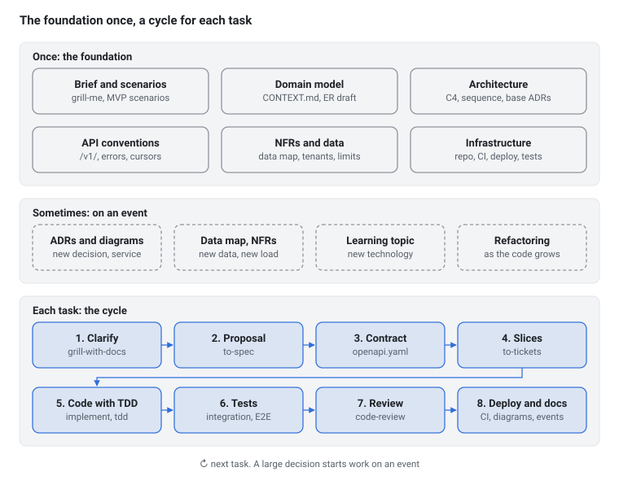

# Development process

The technical process from idea to operation, for one developer with AI agents. Work is split by frequency: the foundation is done once, some work starts on events, and the rest is a cycle for each task. The basis is Matt Pocock's skills for Claude Code, plus our additions for the stack, contracts and data.

## Process diagram



We create the foundation once and later only refine it. The cycle repeats for each task. A large change in the cycle starts work "on an event".

## Foundation: once

Do this before the first line of product code. Without it, agents have nothing to rely on, and each task starts from zero.

| Step | What we do | Artifact | Tool |
| --- | --- | --- | --- |
| Brief and scenarios | The product on one page, the MVP boundaries, the main scenarios with "what if" questions | `docs/dev/brief.md` | grilling |
| Domain model | Entities and relations, one glossary | `CONTEXT.md`, an ER draft | grilling, domain-modeling, Mermaid |
| Architecture | C4 Context and Containers, sequence diagrams for the main flows, base decisions | `docs/dev/architecture.md`, `docs/dev/adr/` | Mermaid |
| API conventions | REST, the `/v1/` version, error format, cursor pagination, naming | `api/openapi.yaml`, [API conventions](tech-stack.md#api-conventions) | OpenAPI, oapi-codegen, openapi-typescript |
| NFRs and data | Response time, availability, limits; the personal data map; the multi-tenancy rule | `docs/dev/nfr.md`, `docs/dev/data-map.md` | — |
| Infrastructure | Monorepo, `CLAUDE.md`, skills, CI, deploy, monitoring, test infrastructure | The repository, `deploy/compose.yaml` | GitHub, Docker, testcontainers, Playwright |

The template already has the infrastructure step and empty templates for the other documents.

## On events

This work has no schedule. A task from the cycle that changes something large starts it.

| Event | What to update |
| --- | --- |
| A new architecture decision: a library, storage, an approach | A new ADR |
| A new service or integration | C4 Containers, sequence diagrams, the contract |
| New personal data or a new storage place | The data map; if necessary, the policy and the consent |
| Load, limits or pricing plans change | NFRs |
| A new technology comes into the project (Redis, a queue, an external service) | A [lesson](../learning/README.md) about the problem that the technology solves |
| The code becomes hard to change; tasks touch many modules | Refactoring with codebase-design |

## Cycle for each task

1. **Clarify.** `grilling` asks questions about the task and updates `CONTEXT.md` and ADRs.
2. **Proposal.** `to-spec` writes the change in the OpenSpec format ([ADR 0002](adr/0002-specs-openspec-hybrid.md)): `openspec/changes/<id>/proposal.md` (goal, what changes, what is out of scope, NFRs, affected personal data) and the deltas of capability specs with GIVEN/WHEN/THEN scenarios. The scenarios are the acceptance criteria. Each requirement has an **origin**: the initial problem, a stressor from a stress round, or a stakeholder (for example, the law on personal data). The origin tells later why the requirement exists. For an expensive decision, the proposal includes a stress round ([AI standard 05](ai-standard/05-human-in-the-loop.md#stress-round)). Write code only after the human approves the proposal.
3. **Design.** Only when the change adds a screen or a flow. The agent gives 2–3 options for the flow and recommends one. Then it makes a clickable prototype of the recommended option as a Claude Design artifact. The prototype uses the design system of the repository (Mantine in the dashboard) and sample data. It shows each state from the spec ([UX standard U5](ux-standard/README.md#design-the-flow-before-the-screen)), the phone screen first. The prototype is not app code: the plan is not approved yet, so the hook blocks code edits. The owner comments, and the agent changes the prototype. When the owner agrees, the owner writes `Design: approved` in the proposal. Only the owner writes this line. The agent saves a screenshot of each state and the exported HTML of the prototype in `openspec/changes/<id>/design/`, so the design stays in the repository if Claude is not available. Without Claude, the prototype is plain HTML that links `web/packages/tokens/css/tokens.css` ([ADR 0015](adr/0015-design-system-and-claude-design.md)). Then the agent fills the "Screens and contract" table in the proposal: each screen and state, its endpoint and its fields. A missing field is marked MISSING. The owner approves the proposal only when no field is missing. Skip this step for backend changes and for small UI fixes without a new screen.
4. **Contract.** Change `openapi.yaml` first, then generate code. Do not write code for a contract that does not exist. The contract gives each field from the "Screens and contract" table.
5. **Slices.** `to-tickets` cuts the proposal into vertical slices in `tasks.md`. Each slice goes through the database, the API, the interface and tests. Each slice becomes an issue on the [GitHub board](ai-standard/02-harness.md#github-task-board). When the change touches more than one layer, the first slice is a tracer slice: the thinnest path through the database, the API, the interface and an E2E test.
6. **Code with TDD.** `tdd`: one failing test, the smallest fix, repeat.
7. **Tests.** Integration tests with testcontainers, Playwright E2E tests for the site and the dashboard.
8. **Review.** The five review steps of [AI standard 03](ai-standard/03-review-verification.md): CI, scenario links, the `architecture-reviewer` agent and `code-review`, the ChatGPT review (`mise run review:codex`), the owner.
9. **Deploy and docs.** CI with tests and a code generation check. A deploy that can roll back comes when we select the hosting ([tech stack](tech-stack.md#in-force-now)): today CI does not deploy. If the API, the schema or a data flow changed, update the diagrams, the data map and `events.md`. Merge the deltas into `openspec/specs/` and archive the change.

Small fixes can use the short path: steps 6–9. For a bug that restores behavior that is already described, the reproduction and a failing test are the spec.

## Parallel work

### One task, several agents

A task is a vertical slice. In the monorepo, its parts are done in parallel in one branch.

1. **The orchestrator** (the main session) does the clarification, the spec, the design and the contract change in sequence: `openapi.yaml`, code generation, commit. Without a fixed contract, do not work in parallel.
2. **The orchestrator does the tracer slice** when the task touches more than one layer: the thinnest path through the database, the API, the interface and an E2E test. The slice shows the gaps between the layers early, while the change is still small. Without it, subagents do not start.
3. **Subagents work in parallel, each in its own folder:** the backend in `/core`, the dashboard in `/web/apps/dashboard`, the site in `/web/apps/site` if the task touches it. Each subagent reads the spec, the contract and its own `CLAUDE.md` and writes code with tests only in its folder.
4. **The orchestrator collects the result:** all tests, a run of the full stack (`mise run up`), E2E by the spec criteria, `code-review`. One PR per task: the review covers the whole feature.

#### Rules

- Only the orchestrator changes shared files: `api/openapi.yaml`, `core/migrations/`, `docs/dev/events.md`, `CONTEXT.md`, `docs/dev/THESAURUS.md`, `openspec/specs/`. The hook enforces this list ([AI standard 02](ai-standard/02-harness.md#hooks)).
- If a field or an endpoint is missing, the subagent stops and tells the orchestrator. The orchestrator changes the contract and gives the change to the others. Agents do not agree on things outside the contract.
- Agent folders do not overlap. If two agents need the same folder, do the parts in sequence.
- Only the E2E tests at the end prove that the feature works, not the tests of separate parts.

**When not to work in parallel:** a small task in 1–2 files; the backend behavior is not clear yet (a spike, a new integration); the data schema changes a lot. In these cases, one agent does the task in sequence: first a spike when the behavior is not clear, then the tracer slice, then the rest. Do not do the whole backend first and the frontend after it: the frontend then finds the gaps in the API too late.

### Several tasks at once

Independent tasks (`to-tickets` shows blocking dependencies) go into separate git worktrees, each with its own orchestrator. Only one task at a time changes the shared hot spots: `openapi.yaml` and migrations. The limit is the review capacity of one person: 2–3 streams at the same time.

## Unknowns and clarifications

| Situation | What we do | Where it is recorded |
| --- | --- | --- |
| A technical question without an answer: a library limit, a browser behavior, a provider API | A spike: a short prototype with a time limit (the `prototype` skill). Tasks that depend on it are blocked until the result | `docs/dev/questions.md` → the result goes into an ADR |
| A question for other people: a lawyer, a partner, a provider | A questionnaire (no skill for it yet). Nobody takes the task until there is an answer | `docs/dev/questions.md` → the answer goes into the spec or an ADR |
| During implementation, we find a small detail that is not in the spec | Edit the spec or the contract and continue | The spec, `openapi.yaml` |
| During implementation, we find a large difference | The task goes back to the "Clarify" step | The spec, `CONTEXT.md`, ADRs |
| It is not clear how to do the task at all | `grilling` or `prototype` before the spec | The spec or an ADR |

The main rule: do not fix a difference from the spec silently in code. Change the document first, then the code. If you do not, the documents quickly drift from the code, and agents start to rely on old information.

## Matt Pocock skills and our additions

Matt Pocock's skills cover the cycle "clarify → spec → tasks → TDD → review" inside one repository, and they focus on TypeScript. They write specs in the OpenSpec format ([ADR 0002](adr/0002-specs-openspec-hybrid.md)). We add the rest ourselves. The [AI standard](ai-standard/README.md) tells how agents go through the cycle, which hooks enforce the rules and how we check the result. The code rules are in the [backend](backend-standard/README.md) and [frontend](frontend-standard/README.md) standards.

| What we need | In Pocock's skills | Our addition |
| --- | --- | --- |
| C4, sequence, DFD diagrams | No | The `docs/dev/architecture.md` template with Mermaid |
| Contracts | No | Contract first: `openapi.yaml` → code generation → a check in CI |
| Spec storage | One file per task | OpenSpec: a living spec per capability and changes to it |
| NFRs | Weak | A required section in the proposal template |
| Personal data | No | A review checklist, the data map |
| Multi-tenancy | No | RLS, a rule in `CLAUDE.md`, "other accounts' data is not visible" tests |
| Go and Astro stack | Partly | Stack rules: Go conventions, sqlc, goose, testcontainers |
| Public site and dashboard | No | Playwright E2E |
| Migrations | No | Only backward compatible; a round-trip test of each migration |
| DevOps | No | CI, deploy, rollback, monitoring |
| Analytics events | No | The `events.md` dictionary |
| Documents are current | Partly | A check before the merge |

Critical at the start: contract first, the multi-tenancy rule and the personal data checklist.

## Documentation in layers

The documentation is in layers, from general to specific, in Markdown next to the code. Claude Code loads `CLAUDE.md` files by hierarchy: an agent in `/web/apps/dashboard` reads the root rules, the frontend rules and the module README, and it does not see the Go rules.

```text
CLAUDE.md                  — rules for the whole project
CONTEXT.md                 — domain model
docs/dev/THESAURUS.md      — glossary
/api/openapi.yaml          — the contract between the frontend and the backend
/openspec
  specs/<capability>/spec.md — the current truth: requirements and scenarios
  changes/<id>/            — proposal, design, tasks, deltas; archived after the merge
/docs
  /dev                     — development
    brief.md               — the product and the MVP boundaries for agents
    architecture.md        — C4, sequence diagrams, code structure rules
    tech-stack.md          — technologies and API conventions
    nfr.md                 — non-functional requirements
    data-map.md            — the personal data map
    events.md              — the analytics event dictionary
    questions.md           — open questions and spikes
    ops.md                 — local environment, backups, logs
    backend-standard/      — backend standard: modules, API, data, jobs, security, tests
    frontend-standard/     — frontend standard: applies in full, deviations through ADRs
    ai-standard/           — AI standard: agent cycle, hooks, review, tools
    adr/                   — architecture decisions
  /learning                — lessons from the real problems of the project
  /images                  — diagrams for all documents
/core                      — Go, one go.mod
  CLAUDE.md                — shared backend rules: Go conventions, sqlc, migrations, tenants
  /cmd/api, /cmd/worker, /cmd/migrate — entry points
  /internal/<module>/README.md — boundaries, tables, events, dependencies
  /internal/platform       — config, db, observability, problem details, test database
  /migrations
/web                       — TypeScript, pnpm workspace
  CLAUDE.md                — shared frontend rules: UI library, style tokens, API client, state, tests
  /packages/api-client     — the client generated from the contract
  /apps/dashboard/README.md
  /apps/site/README.md
  /e2e                     — Playwright end-to-end tests
/deploy                    — Docker Compose and Caddy: a local environment like production
mise.toml                  — tool versions and shared commands: up, gen, test, lint, migrate
```

[ADR 0007](adr/0007-monorepo-layout.md) fixes this layout.

The database schema comes from the migrations. Nobody edits it by hand.

### Who needs what

| What you need to know | Where | Who reads it |
| --- | --- | --- |
| Domain terms | `CONTEXT.md`, `docs/dev/THESAURUS.md` | Everybody |
| Why the task exists and what the result must be | The proposal in `openspec/changes/<id>`; how it works now: `openspec/specs/<capability>` | Everybody who does the task |
| Endpoints, fields, errors | `openapi.yaml` and the generated TS client | Frontend |
| Database and logic design | `/core`, module READMEs | Backend only |
| How to build screens and components | `/web/CLAUDE.md`, the package README | Frontend only |

**The frontend learns about the backend only through the contract.** The frontend does not read Go code. If a field is missing, change the contract first. Until the implementation exists, the frontend works against the Prism mock server from the same contract (`pnpm mock` in `web/`).

**Business requirements are in the proposal and the capability spec:** the goal, the scenarios as acceptance criteria for both sides, and links to `brief.md` and `CONTEXT.md`. Business logic lives on the backend. The frontend shows and checks what the spec says.

### Example: "A user changes their profile name"

1. **Proposal** `openspec/changes/profile-name-edit/` with a delta to the `profile` spec: the scenarios "the new name is visible in the dashboard and on the public site" and "an empty name gives a validation error".
2. **Contract:** `PATCH /v1/dashboard/profile` with the `name` field and validation errors. Generate the Go code and the TS client (`task gen`).
3. **Backend** in `/core/internal/profile`: the implementation, an account isolation test, the `profile.name_changed` event in `events.md`.
4. **Frontend** in `/web/apps/dashboard`: a form with UI library components, handling of the contract errors.
5. **Check:** E2E by the scenarios; update the module README if the module boundaries changed; merge the delta into `openspec/specs/profile`.

Steps 3 and 4 go in parallel: only the contract from step 2 links them.

## Where to start

1. Fill in the one-page [brief](brief.md).
2. Go through the main scenarios with `grilling`.
3. Write the domain model into `CONTEXT.md` and an ER draft.
4. Add the domain to the C4 and sequence diagrams in the [architecture](architecture.md). Record the base ADRs from the decisions that you already made.
5. Add an `openapi.yaml` draft for the MVP scenarios.
6. Fill in the [NFRs](nfr.md) and the [data map](data-map.md).
7. The first cycle tasks are the thinnest end-to-end slices: account → first resource → page.
