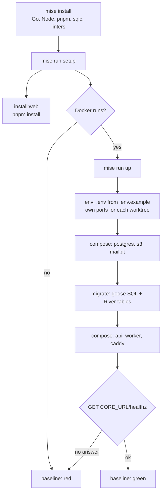
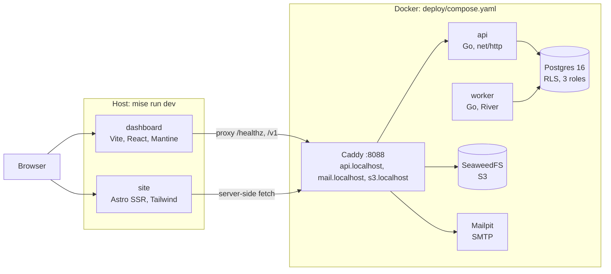
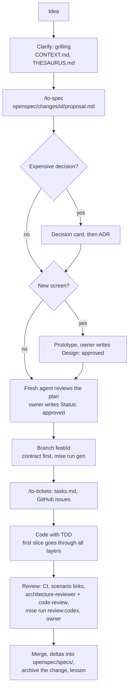

# How the project works

One page with the full picture: how the project starts, what runs, how a change goes from an idea to `main`, which tool checks what, and what is not built yet. The details are in the linked documents. If this page and a linked document do not agree, the linked document is correct. Update this page in the same PR.

Status on 13.11.2026: the infrastructure is ready, and there is no product feature yet. The only working path is the health check. The core has groundwork for the first product slices: accounts and sessions, the event log with an outbox, account isolation with RLS, and the job queue.

## 1. Start

You need [mise](https://mise.jdx.dev) and Docker. mise installs each tool at the version in `mise.toml` and runs all project commands ([ADR 0010](adr/0010-mise-single-toolchain.md)).

- `deploy/worktree-env.sh` gives each git worktree a slot N. Each port is the default port plus N, so parallel agent stacks do not conflict.
- The frontends do not run in Docker yet. `mise run dev` starts them on the host: the dashboard (`dashboard`, Vite) on `DASHBOARD_PORT` and the public pages (`site`, Astro) on `SITE_PORT`.
- `mise run mock` starts a mock API from `api/openapi.yaml` (Prism). The frontend can work before the backend exists.
- Other commands: `mise run down`, `mise run reset` (deletes the data), `mise run logs api`, `mise run db:dump`, `mise run db:restore`. All commands: `mise tasks`.

## 2. What runs and what talks to what

| Part | Where | What it does now |
| --- | --- | --- |
| API contract | `api/openapi.yaml` | `/healthz` and `/readyz`. `mise run gen` makes the Go server code and the TypeScript client from it |
| `api` | `core/cmd/api` | HTTP server: generated handlers, error format (RFC 9457), CSRF protection, logs, traces, metrics on a separate port |
| `worker` | `core/cmd/worker` | Background jobs with River: dispatch of events, hourly cleanup of old sessions |
| `migrate` | `core/cmd/migrate` | goose migrations from `core/migrations/`, then the River tables |
| Modules | `core/internal/accounts`, `core/internal/events` | Sessions, the event log and the outbox. Groundwork: no route uses them yet |
| Database | Postgres | Tables `accounts`, `sessions`, `events`. Each account sees only its rows (RLS, [ADR 0009](adr/0009-account-isolation-rls.md)). Roles: owner for migrations, app for requests, system for jobs |
| S3 and mail | SeaweedFS, Mailpit | Ready for the first features with files and email. No code uses them yet |
| `dashboard` | `web/apps/dashboard` | The dashboard for logged-in users. Shows the health status |
| `site` | `web/apps/site` | The public pages. Shows if the core answers |
| Packages | `web/packages/` | `api-client` (generated), `i18n` (Paraglide, Russian), `tokens` (design tokens) |

The code rules are in the [backend standard](backend-standard/README.md) and the [frontend standard](frontend-standard/README.md). The libraries are in the [tech stack](tech-stack.md#in-force-now).

## 3. From an idea to `main`

The full process is in the [development process](dev-process.md) and [AI standard 01](ai-standard/01-workflow.md). The owner's checklist is in [how to run a task](how-to-run-a-task.md).

The short path for tooling, fixes and docs: a `chore/`, `fix/` or `docs/` branch, the change, `mise run check`, a PR, green CI, merge. No proposal is necessary.

## 4. Who checks what, and when

| When | Tool | What it checks |
| --- | --- | --- |
| An agent edits a file | `.claude/hooks/guard.mjs` | No code edits on `main`. A `feat/` branch needs an approved proposal. A subagent cannot change shared files or merge. No shell reads of `.env`. A push needs an explicit branch |
| After an agent edit | `guard.mjs` | gofmt, go vet, oxlint, oxfmt on the changed files |
| An agent runs `git commit` | `guard.mjs` | The same checks and gitleaks, in 45 seconds or less |
| You run `mise run check` | `mise.toml` | All linters, all tests, the generated code matches the contract |
| A PR changes | `.github/workflows/ci.yml` | The same tasks as `mise run check`, only for the changed parts. E2E in Chromium and WebKit. The docs viewer build when a document changes (`docs:check`). One summary check, `ci-ok` |
| A PR description changes | `.github/workflows/scenarios.yml` | Each spec scenario of a `feat/` branch has a test |
| Each night | `.github/workflows/nightly.yml` | Go tests with the race detector, online link check |
| Each Monday | `.github/workflows/audit.yml` | Known vulnerabilities: govulncheck, osv-scanner |
| Each week or month | Dependabot | New versions of npm, Go, Docker and Actions dependencies, after 7 days (14 days for the docs viewer) |

The list of quality gates, with each tool, is in [AI standard 03](ai-standard/03-review-verification.md#quality-gates). The hooks are in [AI standard 02](ai-standard/02-harness.md#hooks).

## 5. Tools

| Area | Tools |
| --- | --- |
| Toolchain and commands | mise |
| Backend | Go, net/http, oapi-codegen, pgx, sqlc, goose, River, slog, OpenTelemetry, Prometheus, Sentry, testcontainers |
| Frontend | pnpm, Vite, React, Mantine, TanStack Query, React Router, Astro, Tailwind, Paraglide, openapi-fetch, zod, Vitest, Playwright, Prism |
| Local environment | Docker Compose, Postgres, SeaweedFS, Mailpit, Caddy |
| Code checks | golangci-lint, archcheck (`core/tools/archcheck`), squawk, oxlint, oxfmt, TypeScript, Knip |
| Repository checks | gitleaks, rumdl, typos, lychee, jactionlint, zizmor, hadolint, shellcheck, vacuum, oasdiff, agnix |
| Security | govulncheck, osv-scanner, Dependabot |
| Agents | Claude Code: `.claude/settings.json`, the guard hook, skills in `.claude/skills/`, agents in `.claude/agents/`, plugins `mattpocock-skills` and `codex`. Codex: copies in `.codex/` and `.agents/`. MCP: Playwright, Context7 |
| Process | OpenSpec (`openspec/`), the GitHub board, issue and PR templates, [ADRs](adr/), [lessons](../learning/README.md) |
| Docs viewer | VitePress, Mermaid, Scalar: `mise run docs` ([ADR 0016](adr/0016-docs-viewer.md)). Excalidraw sketches, edited in `mise run docs:dev` ([ADR 0017](adr/0017-sketch-editor.md)) |

Each tool in `mise.toml` is used by a task or a workflow. Before you add a tool, check that no gate already does the job ([AI standard 03](ai-standard/03-review-verification.md#rules)).

## 6. Not built yet

These parts are planned. Each one needs a decision of the owner first.

| Part | Now | Where it is planned |
| --- | --- | --- |
| Product features | None. Describe the product first | [Brief](brief.md) |
| Deploy, staging, rollback | No hosting. The stack runs locally | [Tech stack](tech-stack.md), [ops](ops.md) |
| Backups | `mise run db:dump` by hand. | [Ops](ops.md) |
| Logs, traces and alerts | The core sends them, but no server collects them | [Tech stack](tech-stack.md) |
| Secrets management | `.env` files only | [Tech stack](tech-stack.md) |
| Git hooks for commits by a person | Only agent commits are checked locally. CI checks everything | [AI standard 02](ai-standard/02-harness.md#hooks) |
| Agent workflow evals | Not started | [AI standard 03](ai-standard/03-review-verification.md#periodically) |
